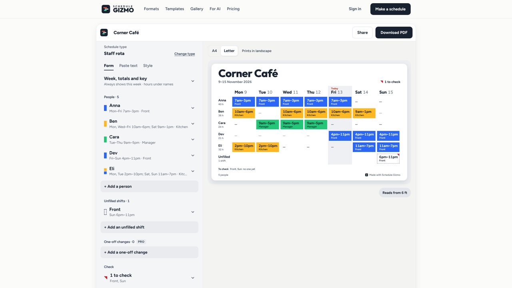
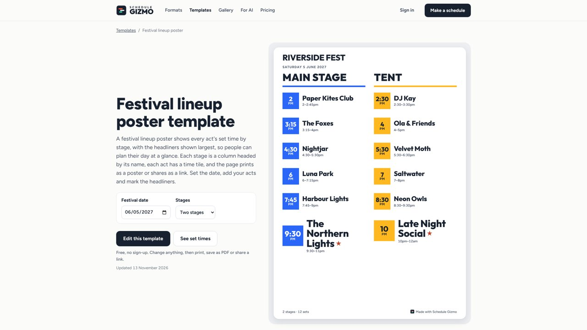

<p align="center"></p>

# Schedule Gizmo MCP server

Make clean one-page schedules from AI assistants. Ask for "a rota for my café next week" or "a Pitman schedule for
four teams" and get a finished, printable page with a link to share it and a link to edit it, instead of a table
in the chat.

- **Remote server:** `https://schedulegizmo.com/mcp` (Streamable HTTP)
- **No sign-in, no API key.** All tools are read-only. Nothing is stored: the schedule travels inside the link.
- **Official MCP Registry:** `com.schedulegizmo/schedule-gizmo`
- **Website:** [schedulegizmo.com](https://schedulegizmo.com) · **Guide for AI assistants:** [schedulegizmo.com/for-ai](https://schedulegizmo.com/for-ai/)



## What it makes

Staff rotas, shift patterns (Pitman, DuPont, 4 on 4 off, Continental, 24/48), on-call rotas, day timelines, event
and conference agendas, wedding timelines, festival lineups, what's-on posters, weekly planners, month calendars and
year planners.

## Tools

| Tool | What it does |
|---|---|
| `make_schedule` | Checks Schedule Gizmo text (unfilled shifts, overlapping shifts, unreadable dates) and returns a view link, an edit link and anything to fix |
| `get_format_guide` | Returns the simple text format schedules are written in |
| `list_templates` | Lists 20+ ready-made templates with their starting text, optionally filtered by a word such as "restaurant" or "pitman" |

## Connect it

**Claude** (claude.ai, desktop or mobile): Settings › Connectors › Add custom connector, then enter
`https://schedulegizmo.com/mcp`. No sign-in.

**Claude Code** (as a plugin, with the skill that teaches the format):

```
/plugin marketplace add ice9products-lab/schedule-gizmo-mcp
/plugin install schedule-gizmo@schedule-gizmo
```

**ChatGPT, Cursor, VS Code and other MCP clients:** add a remote (HTTP) server with this address:

```json
{
  "mcpServers": {
    "schedule-gizmo": { "type": "http", "url": "https://schedulegizmo.com/mcp" }
  }
}
```

**No connector?** Any assistant can still use Schedule Gizmo: point it at
[schedulegizmo.com/llms.txt](https://schedulegizmo.com/llms.txt), which explains how to write the schedule and build
the links itself.

## Example prompts

- Make a staff rota for next week: Anna Mon–Fri 7am–3pm Front, Ben Wed–Sun 12pm–8pm Kitchen, Cara weekends 9am–5pm.
- Set up a 24/48 fire schedule for three platoons starting next Monday.
- Turn this workshop program into a one-page agenda.
- Make a 2027 year planner with UK bank holidays marked.



## Privacy and limits

- No account and nothing stored. Shared links show schedule details only: phone numbers, emails and web addresses
  are hidden, and long text is shortened.
- Requests are rate limited per caller.
- Free to make, print and share. [Schedule Gizmo Pro](https://schedulegizmo.com/pricing/) adds live links that always
  show the latest version, team emails on changes and your own branding.
- [Privacy policy](https://schedulegizmo.com/privacy/) · [Terms](https://schedulegizmo.com/terms/)

## What's in this repository

This repository holds the connector's public description, not the service's code (the server runs at
schedulegizmo.com).

- `server.json`: the listing in the official MCP Registry
- `plugins/schedule-gizmo/`: Claude plugin (connector + skill); `.claude-plugin/marketplace.json` makes this repository
  a plugin marketplace
- `images/`: icon and screenshots

Questions or problems: team@schedulegizmo.com
